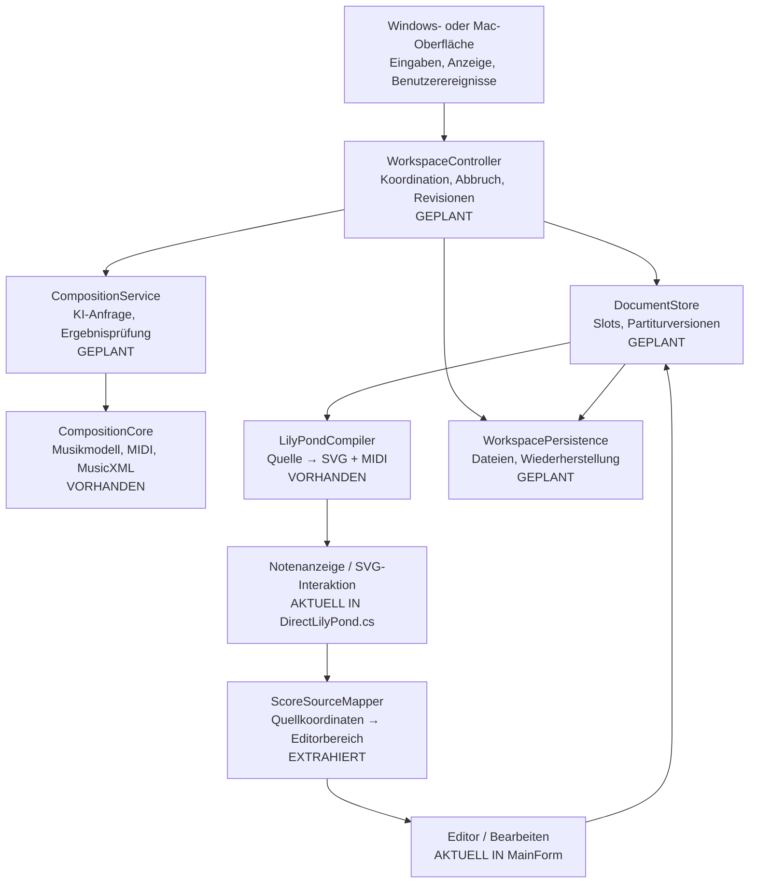
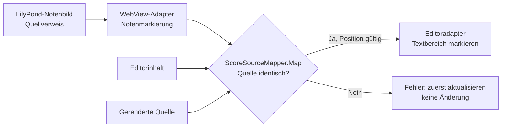

# Composition Lab – Modularchitektur und Datenfluss

Stand: 16.10.2026 · Branch `v4-cross-platform` · **schrittweiser Umbau, nicht abgeschlossen**

## Zielbild des Programms

Die Pfeile zeigen das geplante **Aufruf-/Datenflussmodell**, nicht lauter bereits implementierte unabhängige Klassen. VORHANDEN und EXTRAHIERT sind echte technische Einheiten. GEPLANT ist ausdrücklich **noch nicht implementiert**.

## Erster realer Modulschnitt: ScoreSourceMapper

Pfad: `Windows/CompositionLab/ScoreSourceMapper.cs`. Unabhängig von WinForms, WebView2, Dateisystem, Audio, KI und LilyPond-Prozess.

**Vertrag:** `Map(string renderedSource, string editorSource, Point from, Point to) -> (Span? Range, Error Failure)`.

| Parameter | Eingabe / Ausgabe | Bedeutung |
|---|---|---|
| `renderedSource: string` | Input | Die exakte LilyPond-Quelltextfassung, aus der die Notengrafik erzeugt wurde |
| `editorSource: string` | Input | Aktuell im Editor sichtbarer Text; muss identisch mit `renderedSource` sein |
| `from: Point(Line:int, Column:int)` | Input | Anfang einer Quelltextauswahl aus dem LilyPond-SVG; 1-basiert |
| `to: Point(Line:int, Column:int)` | Input | Ende einer Quelltextauswahl aus dem LilyPond-SVG; 1-basiert |
| `Range: Span?(Start:int, Length:int)` | Output | Null oder UTF-16-Textbereich für `RichTextBox.SelectionStart/SelectionLength` |
| `Failure: Error` | Output | `None`, `StaleSource`, `InvalidPosition`, `EmptySource` |

**Invarianten:** Kein stillschweigendes Zusammenführen veralteter Editorstände, kein Ersetzen von Notentext, kein Zugriff auf die GUI. Ungültige Positionen erzeugen einen Fehler. Der Aufrufer entscheidet über Statusmeldung, Tabwechsel und Fokussierung.

**Vorab-Simulation / Testfälle:** gültige mehrzeilige Auswahl, umgekehrte Auswahl, ungültige Zeile, veralteter Editorinhalt. Die Tests sind in `ScoreSourceMapper.SelfTest` beschrieben und über die Windows-Testreihe verbunden.

## Weiterer Umbau – Reihenfolge

1. Koordination und asynchrone Revisionen (`WorkspaceController`) isolieren; keine Ergebnisse alter Slotwechsel übernehmen.
2. Slotbesitz und Partiturrevision (`DocumentStore`) von GUI-Feldern trennen.
3. Persistenz transaktional auslagern (`WorkspacePersistence`), alte `.clab`-/Projektdateien erhalten.
4. SVG-Notenauswahl und Editoreingriff als separate Adapter mit klarer Quellrevision.
5. KI-Kompositionsablauf und Player durch explizite Services/Adapter ersetzen, Regressionen erhalten.
6. Danach **neue** Auswahl-/Editierfunktion als Ende-zu-Ende-Test der Modulgrenzen.

## Freigabestatus

Dies ist keine neue freigegebene Windows-Version. Die Trennung des ersten Moduls ist eingecheckt; weitere Architekturarbeiten und Gesamtprüfungen sind noch erforderlich. Nicht getestete Teilstände werden nicht als fertige Anwendung ausgegeben.

Siehe auch [DEVELOPMENT-MODULES.md](DEVELOPMENT-MODULES.md) und [V4-ARCHITECTURE.md](V4-ARCHITECTURE.md).
