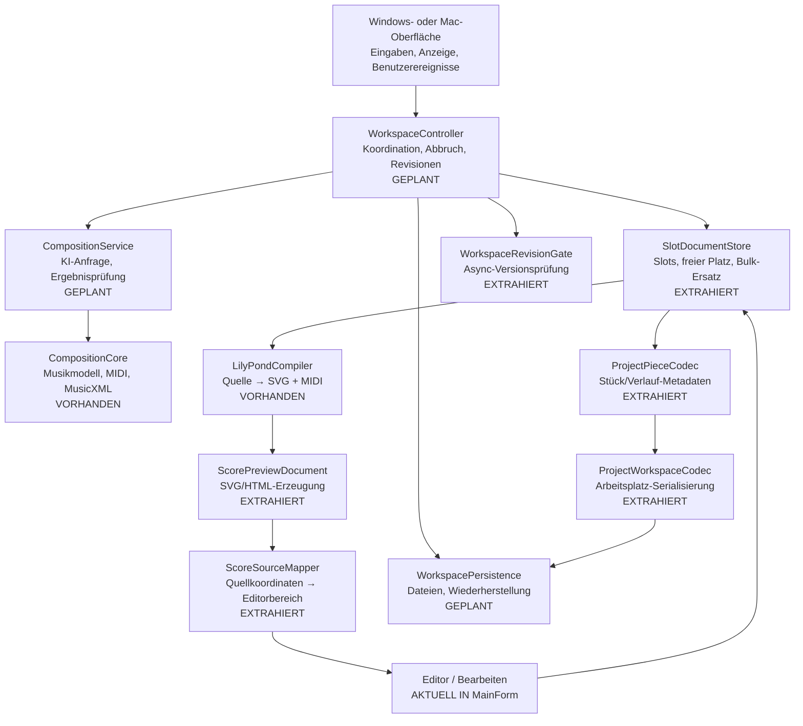
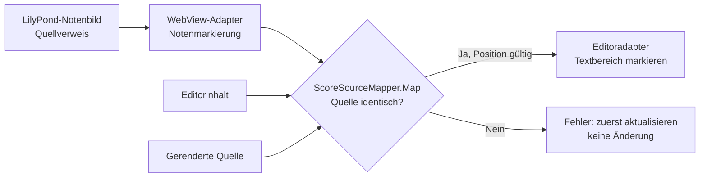

# Composition Lab – Modularchitektur und Datenfluss

Stand: 16.10.2026 · Branch `v4-cross-platform` · **schrittweiser Umbau, nicht abgeschlossen**

## Zielbild des Programms

Die Pfeile zeigen das geplante **Aufruf-/Datenflussmodell**, nicht lauter bereits implementierte unabhängige Klassen. VORHANDEN und EXTRAHIERT sind echte technische Einheiten. GEPLANT ist ausdrücklich **noch nicht implementiert**.

## Zweiter realer Modulschnitt: ScorePreviewDocument

Pfad: `Windows/CompositionLab/ScorePreviewDocument.cs`. Reines Modul ohne WinForms oder WebView2. Vertrag: `Build(string[] svgPages) -> string html`.

**Input:** Mindestens eine vollständig von LilyPond generierte SVG-Seite (UTF-8-Inhalt als Zeichenfolge). **Output:** Ein lokales HTML-Dokument mit Seitendarstellung, Klick-/Drag-Auswahl und Nachrichtenvertrag `{action:"select-source",line:int,column:int,endLine:int,endColumn:int}`. **Fehler:** Leere Seitenliste wird als ungültige Eingabe abgelehnt. **Nebenwirkungen:** Keine; der Host speichert und navigiert das Ergebnis. Der GUI-Adapter `DirectLilyPond.RenderLilyPond` übernimmt weiterhin ausschließlich Cache-Datei und WebView-Navigation.

## Erster realer Modulschnitt: ScoreSourceMapper

Pfad: `Windows/CompositionLab/ScoreSourceMapper.cs`. Unabhängig von WinForms, WebView2, Dateisystem, Audio, KI und LilyPond-Prozess.

**Vertrag:** `Map(string renderedSource, string editorSource, Point from, Point to) -> (Span? Range, Error Failure)`.

| Parameter | Eingabe / Ausgabe | Bedeutung |
|---|---|---|
| `renderedSource: string` | Input | Die exakte LilyPond-Quelltextfassung, aus der die Notengrafik erzeugt wurde |
| `editorSource: string` | Input | Aktuell im Editor sichtbarer Text; muss identisch mit `renderedSource` sein |
| `from: Point(Line:int, Column:int)` | Input | Anfang einer Quelltextauswahl aus dem LilyPond-SVG; 1-basiert |
| `to: Point(Line:int, Column:int)` | Input | Ende einer Quelltextauswahl aus dem LilyPond-SVG; 1-basiert |
| `Range: Span?(Start:int, Length:int)` | Output | Null oder UTF-16-Textbereich für `RichTextBox.SelectionStart/SelectionLength` |
| `Failure: Error` | Output | `None`, `StaleSource`, `InvalidPosition`, `EmptySource` |

**Invarianten:** Kein stillschweigendes Zusammenführen veralteter Editorstände, kein Ersetzen von Notentext, kein Zugriff auf die GUI. Ungültige Positionen erzeugen einen Fehler. Der Aufrufer entscheidet über Statusmeldung, Tabwechsel und Fokussierung.

**Vorab-Simulation / Testfälle:** gültige mehrzeilige Auswahl, umgekehrte Auswahl, ungültige Zeile, veralteter Editorinhalt. Die Tests sind in `ScoreSourceMapper.SelfTest` beschrieben und über die Windows-Testreihe verbunden.

## Dritter realer Modulschnitt: WorkspaceRevisionGate

Pfad: `Windows/CompositionLab/WorkspaceRevisionGate.cs`. Zustandseigentümer ausschließlich für die monoton steigende Generation laufender Anzeige-/Ladeoperationen.

- `Begin() -> int`: erhöht die Revision beim Start einer neuen Slotanzeige.
- `Current -> int`: aktuelle Revision für bereits laufende Arbeit.
- `IsCurrent(expected:int) -> bool`: alte asynchrone Antworten werden ohne GUI-Abhängigkeit erkannt.
- Seiteneffekte: Nur interner Revisionszähler; keine Dateizugriffe.
- Test: Folge zweier Starts muss das ältere Token zuverlässig abweisen.

## Vierter realer Modulschnitt: ProjectPieceCodec

Pfad: `Windows/CompositionLab/ProjectPieceCodec.cs`. Reine Umwandlung gespeicherter Stück-/Verlaufsmetadaten.

- `ToHistory(document:JsonObject, fallbackProvider:string, fallbackModel:string) -> JsonObject`
- `CopySavedPieceMetadata(source:JsonObject, target:JsonObject) -> void`: überträgt die bekannten optionalen Metadaten mittels DeepClone; die Zielinstanz ist expliziter Output/Seiteneffekt.
- Fehler: Fehlender Titel oder fehlende Partitur wird abgelehnt.
- Tests: Musikquelltext, ursprünglicher Kompositionsauftrag und Providerangaben bleiben beim Roundtrip erhalten. Die zunächst gefundene Metadatenlücke für `assignment`, Tempo-/Ensembleparameter und importiertes MusicXML wurde geschlossen.
- **Noch offen:** Vollständige Projektlade- und Commit-Transaktion ist noch mit `MainForm` verbunden; dieses Modul ist nicht schon die komplette Persistenzschicht.

## Fünfter realer Modulschnitt: ProjectWorkspaceCodec

Pfad: `Windows/CompositionLab/ProjectWorkspaceCodec.cs`. Reines Modul zum Zusammenstellen eines gespeicherten `.clabproject`-Workspace-Dokuments aus ausdrücklich übergebenen Parametern.

- `Encode(name:string, settings:JsonObject, editorText:string, documents:IReadOnlyList<JsonObject?>, activeSlot:int, history:IReadOnlyList<JsonObject>, chatText:string, fallbackProvider:string, fallbackModel:string) -> JsonObject`
- **Output:** Versioniertes JSON (`composition-lab-v6-project`) mit Slots, aktiver Auswahl, Historie und Einstellungen; bestehendes Dateiformat unverändert.
- **Grenzfälle:** Ungültige aktive Slotnummer wird abgelehnt; Eingabedaten werden beim Serialisieren geklont, damit spätere Bearbeitung den Export nicht verändert.
- **Noch ausstehend:** `WorkspacePersistence` für Dateizugriff, Validierung und transaktionales Projektladen; noch im GUI-Adapter.

## Sechster realer Modulschnitt: SlotDocumentStore

Pfad: `Windows/CompositionLab/SlotDocumentStore.cs`. Speichert Slots hinter einer eigenen Schnittstelle statt eines von allen Dateien gemeinsam verwalteten Arrays.

- `new SlotDocumentStore(capacity:int)`: positive Kapazität erforderlich.
- `this[index:int]: JsonObject?` (get/set): prüft Indexgrenzen über Arrayindexer; erlaubt gezielten Slotzugriff und bewusstes Entfernen mit `null`.
- `FirstFreeIndex() -> int`: erster freier Slot oder `-1`.
- `IndexOfReference(document:JsonObject) -> int`: eindeutige Referenzposition oder `-1`, für Undo/Redo.
- `ReplaceAll(next:IReadOnlyList<JsonObject?>) -> void`: vollständige, synchrone Übernahme nach passender Slotanzahl. Bei Abweichung Fehler **ohne Änderung**.
- `Count`, `Length`, `IEnumerable<JsonObject?>`: lesende Integrationsschnittstellen mit vorhandenen Export-/GUI-Workflows.

**Wichtige Übergangsbeschränkung:** Die enthaltenen `JsonObject`-Partituren bleiben vorerst in-place veränderbar. Ein zukünftiges Modul für immutable Dokumentrevisionen ist nötig, bevor wir vollständige Transaktionssicherheit behaupten können.

## Weiterer Umbau – Reihenfolge

1. Die jetzt extrahierte Revisionsprüfung in einen vollständigen `WorkspaceController` mit Abbruch- und Commitregeln integrieren; keine Ergebnisse alter Slotwechsel übernehmen.
2. Das jetzt isolierte `SlotDocumentStore` weiter von direkter `JsonObject`-Mutation entkoppeln; atomare Partiturrevisionen und Besitzerregeln einführen.
3. Persistenz transaktional auslagern (`WorkspacePersistence`), alte `.clab`-/Projektdateien erhalten.
4. SVG-Notenauswahl und Editoreingriff als separate Adapter mit klarer Quellrevision.
5. KI-Kompositionsablauf und Player durch explizite Services/Adapter ersetzen, Regressionen erhalten.
6. Danach **neue** Auswahl-/Editierfunktion als Ende-zu-Ende-Test der Modulgrenzen.

## Freigabestatus

Dies ist keine neue freigegebene Windows-Version. Die Trennung des ersten Moduls ist eingecheckt; weitere Architekturarbeiten und Gesamtprüfungen sind noch erforderlich. Nicht getestete Teilstände werden nicht als fertige Anwendung ausgegeben.

Siehe auch [DEVELOPMENT-MODULES.md](DEVELOPMENT-MODULES.md) und [V4-ARCHITECTURE.md](V4-ARCHITECTURE.md).
