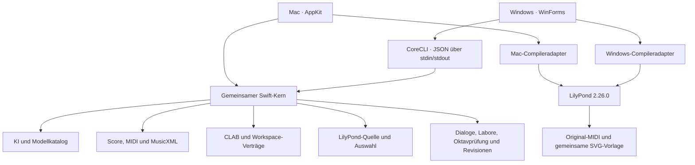

# Aktuelle Architektur

Die historischen Abschnitte unten beschreiben die frühen V4-Alphas.
Maßgeblich sind [DEVELOPMENT-MODULES.md](DEVELOPMENT-MODULES.md) und
[V4.2-AUDIT.md](V4.2-AUDIT.md). Die Oberflächen werden nicht angeglichen.

Der Kern enthält keine AppKit-/WinForms-Fenster und keine DAW-Dateiwächter.
Die Oberflächen besitzen ihre nativen Controls, Schlüsselablagen und Player.
Anfragen und Quelltextbearbeitungen übernehmen Ergebnisse erst nach Validierung;
Quellrevision und Ziel-Slot dürfen sich zwischen Start und Übernahme nicht ändern.
Die gemeinsame Playback-Kopie verändert ausschließlich Anschlagsstärken und
Tempi für den Player. Exportdaten bleiben unverändert, Tempoverläufe bleiben
relativ erhalten. Gemeinsame Dialog-, Labor-, Register- und Revisionsdienste
besitzen die fachlichen Regeln; große native Fenstercontroller koordinieren
weiterhin die Controls. Betriebssystemadapter werden bewusst nicht vereinheitlicht.

---

# Composition Lab 4.0 – gemeinsame Mac-/Windows-Basis

Stand: 2026-10-13 · 4.0.0-alpha.5 · Build 4005

## Schutz der bisherigen Version

`main` und `reference-v3.5.3-before-v4` bleiben auf
`a2aefd72c53878019058bdc6f6a2ffec2c4615dc` unverändert.
Dieser Zweig ist `v4-cross-platform`. Die neue Mac-App heißt **Composition Lab 4.0**,
hat die Bundle-ID `de.klangwerke.compositionlab.native.v4`, einen getrennten
Einstellungsspeicher sowie einen eigenen Ordner für API-Schlüssel.
Der Build beendet keine laufende 3.5.3-App und ersetzt deren App-Bundle nicht.
Reaper-Ausgaben liegen unter `Composition Lab 4.0`; Studio-Pro-Rückgabedateien
heißen `CompositionLab_V4_Return.*`. Die bisherigen DAW-Skripts müssen für diese
neuen Pfade ausdrücklich angepasst werden. Automatische Rückgaben überschreiben
keine Dateien der alten App.

## Ein gemeinsamer Quellbaum

`Shared/CompositionCore/` enthält Datenmodell, Engine-Prompts, KI-Anfragen,
Kompositionsablauf, MIDI, MusicXML, Projekt-Datenstrukturen und Verlaufsspeicherung.
Es enthält keine AppKit-, CoreMIDI-, AVFoundation-, Security- oder WebKit-Abhängigkeit.
Die SwiftPM-Bibliothek `CompositionCore` verwendet exakt diese Quellen.
Der Mac-Build kompiliert dieselben Dateien zusammen mit den AppKit-Adaptern;
es gibt keine zweite Kopie der Engine oder der Import-/Export-Logik.
Der öffentliche Einstieg `CoreServices` nimmt JSON/Data entgegen, sodass Clients
die internen Swift-Datentypen nicht nachbauen müssen.

`CompositionWorkflow` führt die bisherige Engine-2.3.1-Pipeline aus:
1. fertige musikalische Komposition;
2. werkgetreue technische Übersetzung;
3. technische Prüfung und Ergebnisübernahme.

Die Mac-Oberfläche verwendet diesen Ablauf bereits. KI-Client und Oberflächen-Callbacks
sind getrennt. Tests können Antworten einspeisen, ohne kostenpflichtige KI-Anfragen
auszulösen. Diagnose enthält Komposition, technische Antwort, Score, Tokens und
geschätzte Kosten. Die Preisberechnung wurde unverändert übernommen und liefert
weiterhin eine Schätzung, keine providerseitig bestätigte Abrechnung.

## Plattformadapter

`Sources/` enthält weiterhin Mac-Fenster, Player, MIDI-Geräte, WebKit/PDF-Ausgabe,
verschlüsselte Schlüssel/Backups sowie DAW-Pfade. Die Windows-Oberfläche unter `Windows/CompositionLab` ruft denselben Kern über
einen stdin/stdout-Prozesskanal auf. Schlüssel bleiben aus Prozessargumenten und
Dateiaufträgen heraus. DPAPI schützt gespeicherte Schlüssel; der Player verwendet
den Windows-MIDI-Sequencer. Noch nicht ausgelagert sind Teile der
Dialog-/Slot-Steuerung, Revisionen und der experimentelle Motivpfad. Diese verwenden
bereits gemeinsame Daten/Prompts, aber noch keinen vollständig gemeinsamen Ablauf.
Die erste Windows-Desktop-Alpha ist umgesetzt; die vollständige funktionale
Gleichstellung mit der Mac-App ist noch offen.

## Prüfung und Builds

`swift test` prüft MIDI, bestehende MusicXML-Fixtures, Notations-/Playback-Trennung,
CLAB-Lesbarkeit, Kompositionsstufen, Fehlerdiagnose und Geheimnisfreiheit.
`swift build -c release` baut Bibliothek und das Prüf-/Konvertierungsprogramm
`composition-lab-core`. Die GitHub-Matrix führt dies auf Mac, Windows und Linux aus;
zusätzlich baut sie die isolierte Mac-App für Intel und Apple Silicon.
Der Windows-Build packt jetzt auch die grafische App sowie die benötigten
Runtime-DLLs ein und führt einen echten GUI-/Datei-/Schlüssel-Starttest aus.
Ein erfolgreicher Build ersetzt keine praktische Abnahme der Oberfläche/Wiedergabe.

`CoreServices.compose` stellt denselben Ablauf als asynchrones JSON-API für andere
Clients bereit. Der API-Schlüssel wird getrennt vom Auftragsdokument übergeben.
Nächste Schritte: praktische Windows-Abnahme, gemeinsame Dialog-/Slot-
Zustandsverwaltung, Soundfont-/MIDI-Gerätewahl und zusätzliche DAW-Adapter.

## Windows-Darstellung Alpha 5

`Windows/CompositionLab/StudioTheme.cs` kapselt Farben, gerundete Flächen,
Schaltflächen, Stück-Karten und den Wechsel zwischen Arbeitsbereichen.
`MainForm` setzt die Werkstatt aus diesen Bausteinen zusammen. Diese Windows-
Adapter führen keine musikalische Änderung oder neue KI-Anfrage aus. Die zehn
Stück-Plätze und Schlüsselablage verwenden weiterhin die bisherigen Datenpfade.

## Mac-GUI-Port Alpha 6 (14.10.2026)

`Shared/Interface/MAC-GUI-REFERENCE.md` dokumentiert die maßgebliche Mac-Quelle.
`Windows/CompositionLab/MacGui.cs` übernimmt deren Main-/Noten-/Technik-Builder.
Ein Startschalter nimmt die reale Mac-Oberfläche in der CI als Referenz auf.
Die Windows-Oberfläche nutzt den gleichen MusicXML-Exporter mit denselben
Preset-Werten; ein Änderungsprofil beeinflusst MIDI und Score nicht. Das
Mac-Arbeitsplatzformat `composition-lab-v6-project` wird im Kern geprüft.

Der eigene Windows-4.0-Datenspeicher und DPAPI-Schlüssel bleiben erhalten.
Die isolierte Mac-App verwendet ihren Standard-Preferences-Domain, statt
ihre eigene Bundle-ID als fremde Suite zu öffnen. Original-`main` bleibt
unverändert. Schrift, native Systemdialoge und noch fehlende Plattformadapter
sind in der Windows-Anleitung ausdrücklich getrennt von der GUI-Portierung.
